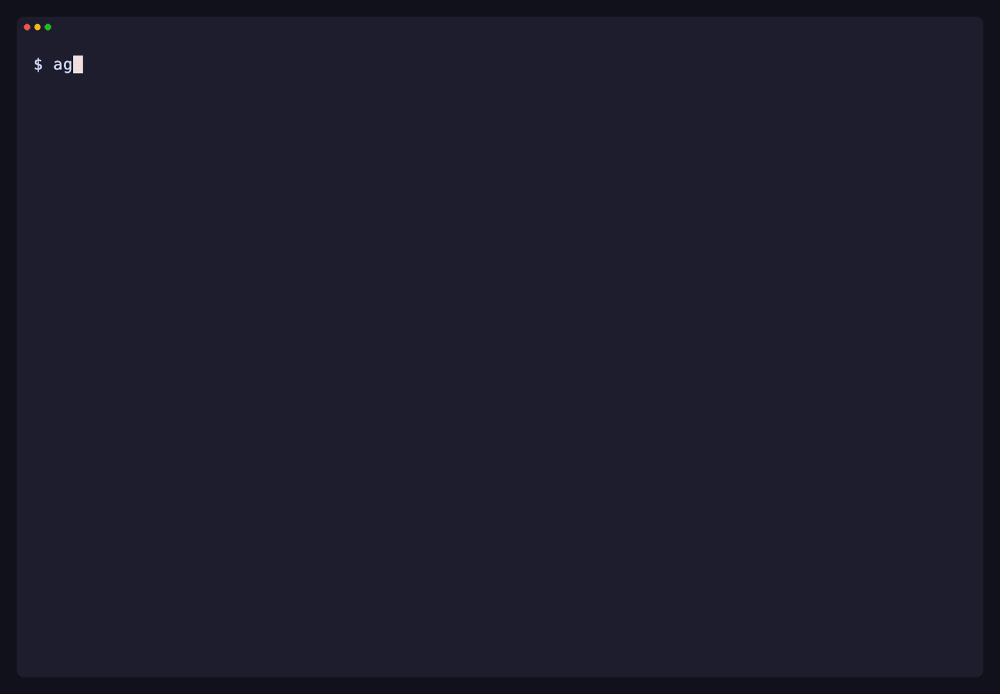
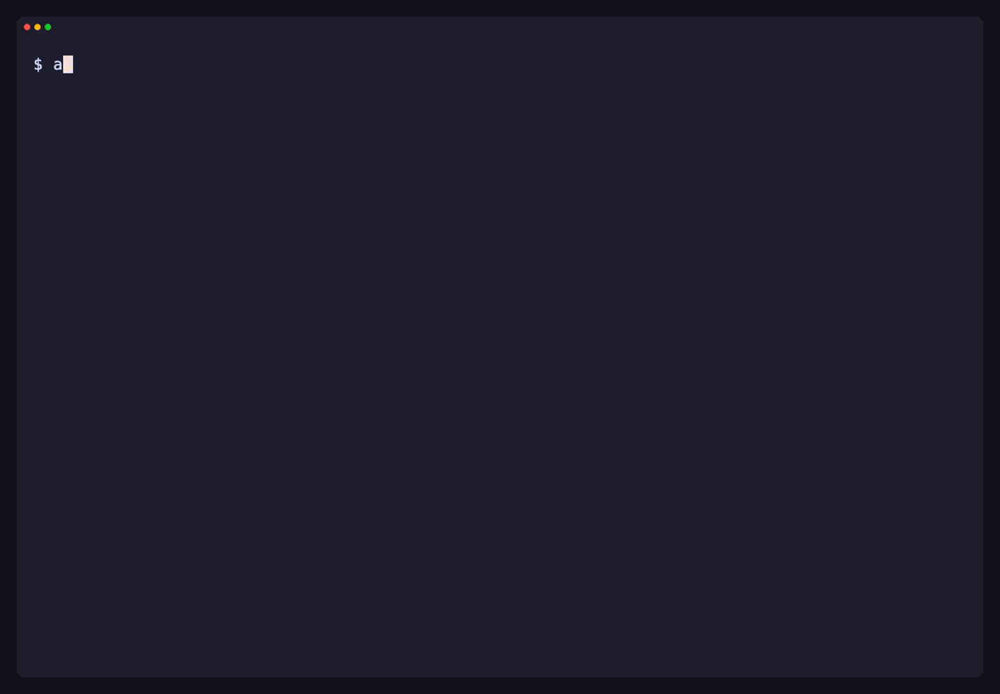
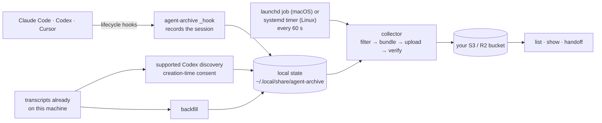

# agent-archive

[](https://github.com/wangjohn/agent-archive/actions/workflows/test.yml)
[](go.mod)
[](LICENSE)

A lightweight CLI that captures Claude Code, Codex, and Cursor sessions and stores them in cloud storage (S3 or R2).

OpenAI and Anthropic are constantly one-upping each other or the best model, but it's a pain to switch between their coding agents. Every time you switch, you lose your history, and then don't have a single source of truth for where all your sessions live. Also, if you run out of limits in the middle of a session, it's very annoying to have to figure out how to hand that session over to the other coding agent.

`agent-archive` solves these problems, and can perform the following:

- Automatically upload Claude Code, Codex, and Cursor transcripts into a cloud object storage like S3 or R2.
- Hand off a session to another coding agent or computer without losing context. Run `agent-archive handoff` and pick a session. After setup, you can also ask Claude Code or Codex to continue a previous session by name; the agent uses the CLI to find it and load its context. Useful when you hit rate limits or want to switch models ([handoff guide](docs/guides/handoff.md)).

  

- View all of your past sessions across coding agents with `agent-archive list`. Find a session by topic, project, branch, or PR number, then open it to revisit the conversation ([browsing guide](docs/guides/list-and-show.md)).

  

- See how you're using your coding agents with `agent-archive stats`. Track session counts, tokens, and estimated spend, and compare usage across agents, models, and projects ([usage guide](docs/guides/stats.md)).

  

## Quickstart

1. **Install on macOS:**

   ```sh
   curl -fsSL https://raw.githubusercontent.com/wangjohn/agent-archive/v0.1.1/install.sh | AGENT_ARCHIVE_VERSION=v0.1.1 sh
   ```

   The published v0.1.1 binaries are macOS only. For Linux and the newer features shown here, [build from source](docs/getting-started/install.md#build-from-source).

2. **Run setup** inside your project to configure capture and private S3 or R2 storage:

   ```sh
   agent-archive setup
   ```

3. **Hand off a session** to another agent:

   ```sh
   agent-archive handoff
   ```

[Setup guide](docs/getting-started/setup.md) · [Bucket options](docs/getting-started/bucket.md) · [Platforms](docs/getting-started/install.md#platforms) · [Privacy](docs/security/privacy.md) · [Multiple machines](docs/guides/multiple-machines.md)

## Understand your usage

Run `agent-archive stats` to explore session counts, tokens, estimated spend, and breakdowns by agent, model, and project. Switch views with a keypress ([usage guide](docs/guides/stats.md)).

## Find and revisit sessions

Run `agent-archive list` to browse archived sessions across agents. Press `/` to filter by topic, project, branch, or PR number, then select a session to view it ([browsing guide](docs/guides/list-and-show.md)).

Use a session ID from `list` with `agent-archive show SESSION_ID` to open its summary, or add `--transcript` to read the conversation.

Setup also gives Claude Code, Codex, and Cursor an `agent-archive` skill, so you can ask an agent to "pull in the auth session from Codex" and it runs the read-only commands for you; Claude Code asks before it first uses the skill and before it runs its commands ([agent skills](docs/guides/agent-skills.md#permissions)). After upgrading, `install.sh` runs `agent-archive setup --refresh` to keep the skills current.

## How it works



Setup edits each included app's hook settings, adds one background job (a LaunchAgent on macOS, a systemd user timer on Linux), and writes two skill files for Claude Code (in `~/.claude/skills`) and two for Codex and Cursor together (in `~/.agents/skills`; `agent-archive setup --no-skills` skips them); for Cursor it also adds a missing `version` field ([everything it changes](docs/getting-started/setup.md#what-setup-changes-on-your-machine)). Old sessions are deleted from the bucket after 90 days by default.

## Command reference

| Command | What it does | Example |
| --- | --- | --- |
| `setup` | Configure apps, projects, and storage. | `agent-archive setup` |
| `status` | Check capture health and see what to do next; `status claude` shows one app in full. | `agent-archive status` |
| `sync` | Collect and upload pending sessions now. | `agent-archive sync` |
| `pause`, `resume` | Pause collection, uploads, and cleanup until you resume ([everyday commands](docs/guides/troubleshooting.md#everyday-commands)). | `agent-archive pause` |
| `list` | Find archived sessions, by filters or by a few words. | `agent-archive list "retention"` |
| `search` | Search conversation text in a private local index ([search guide](docs/guides/search.md)). | `agent-archive search "upload checksum"` |
| `show` | View a session's summary, or its transcript with `--transcript`. | `agent-archive show SESSION_ID` |
| `stats` | See your usage: tokens by day, estimated cost, agents, models, projects, highlights. | `agent-archive stats --days 7` |
| `backfill` | Preview sessions already on this machine for import. | `agent-archive backfill --dry-run` |
| `handoff` | Continue a session in another agent; inside Claude Code, `/handoff codex`. | `agent-archive handoff` |

Listings return at most 50 matching sessions by default: text shows top-level sessions by last activity; JSON includes subagents and sorts by capture time. For analytics over every match, use `agent-archive list --json --limit 0`; add `--all-projects` to include every project when running inside a repository, and `--replays include` if your analysis should include replay sessions (hidden by default). Unreadable metadata is skipped with a warning on stderr ([list guide](docs/guides/list-and-show.md), [JSON contract](docs/reference/json-output.md)).

More commands (machines, uninstall, purge, …) are under `agent-archive help advanced`; for every command and option, see the **[full CLI reference](docs/reference/cli.md)** or run `agent-archive help COMMAND`.

[Install](docs/getting-started/install.md) ·
[Setup](docs/getting-started/setup.md) ·
[Troubleshooting](docs/guides/troubleshooting.md) ·
[FAQ](docs/guides/faq.md) ·
[Privacy](docs/security/privacy.md) ·
[All docs](docs/README.md)

## Contributing and security

See [CONTRIBUTING.md](CONTRIBUTING.md); test without touching your real machine ([sandbox recipe](dev/contributing/testing.md)). Report vulnerabilities privately as [SECURITY.md](SECURITY.md) describes. Changes are in [CHANGELOG.md](CHANGELOG.md). Released under the [MIT License](LICENSE).
