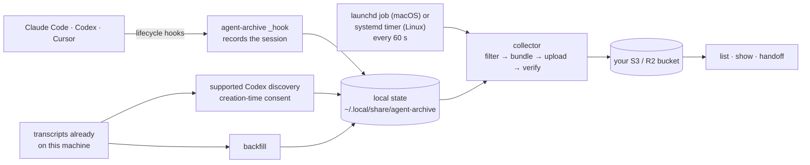

# agent-archive: Session handoffs and backups for Claude Code, Codex, and Cursor

[](https://github.com/wangjohn/agent-archive/actions/workflows/test.yml)
[](go.mod)
[](LICENSE)

Continue a Claude Code session in Codex, or vice-versa. You can pick a session and bring its conversation context into another coding agent. Add your own S3 or R2 bucket for automatic backups and access from other machines.

OpenAI and Anthropic are constantly one-upping each other for the best model and harness, but it's a pain to switch between their coding agents, especially if you have multiple computers and accounts. You lose your conversation history as you switch and then have to search in multiple places to figure out where you working on something. You also can't introspect your sessions as easily.

`agent-archive` solves these problems, and can perform the following:

- **Continue across agents and computers.** Run `agent-archive handoff` to pick a session and continue with its context. After setup, you can also ask Claude Code or Codex to continue a previous session by name; the agent uses the CLI to find it and load its context. Useful when you hit rate limits or want to switch models ([handoff guide](docs/guides/handoff.md)).

  

- **Archive automatically.** Upload Claude Code, Codex, and Cursor transcripts to your own S3 or R2 bucket.

- **Browse your session history.** Use `agent-archive list` to browse sessions across coding agents. Filter by topic, project, branch, or PR number, then open a session to revisit the conversation ([browsing guide](docs/guides/list-and-show.md)).

  

- **See your usage and spend.** Track session counts, tokens, and estimated spend with `agent-archive stats`, broken down by agent, model, and project ([usage guide](docs/guides/stats.md)).

  

## Quickstart

1. **Install:**

   ```sh
   curl -fsSL https://raw.githubusercontent.com/wangjohn/agent-archive/v0.1.1/install.sh | AGENT_ARCHIVE_VERSION=v0.1.1 sh
   ```

   Note the published binaries are macOS only.

2. **Continue a session in another agent**:

   ```sh
   agent-archive handoff
   ```

   Pick an existing Claude Code or Codex session, choose the receiving agent, and continue with its conversation context.

3. **Enable automatic archiving (optional)**:

   ```sh
   agent-archive setup
   ```

  Connect your own S3 or R2 bucket if you want your sessions backed up and available from another computer.


[Setup guide](docs/getting-started/setup.md) · [Bucket options](docs/getting-started/bucket.md) · [Platforms](docs/getting-started/install.md#platforms) · [Privacy](docs/security/privacy.md) · [Multiple machines](docs/guides/multiple-machines.md)

## How it works



Setup edits each included app's hook settings, adds one background job (a LaunchAgent on macOS, a systemd user timer on Linux), and writes two skill files for Claude Code (in `~/.claude/skills`) and two for Codex and Cursor together (in `~/.agents/skills`; `agent-archive setup --no-skills` skips them); for Cursor it also adds a missing `version` field ([everything it changes](docs/getting-started/setup.md#what-setup-changes-on-your-machine)). Old sessions are deleted from the bucket after 90 days by default.

## Command reference

| Command | What it does | Example |
| --- | --- | --- |
| `setup` | Configure apps, projects, and storage. | `agent-archive setup` |
| `status` | Check capture health and see what to do next; `status claude` shows one app in full. | `agent-archive status` |
| `sync` | Collect and upload pending sessions now. | `agent-archive sync` |
| `pause`, `resume` | Pause collection, uploads, and cleanup until you resume ([everyday commands](docs/guides/troubleshooting.md#everyday-commands)). | `agent-archive pause` |
| `list` | Find archived sessions, by filters or by a few words. | `agent-archive list "retention"` |
| `search` | Search conversation text in a private local index ([search guide](docs/guides/search.md)). | `agent-archive search "upload checksum"` |
| `show` | View a session's summary, or its transcript with `--transcript`. | `agent-archive show SESSION_ID` |
| `stats` | See your usage: tokens by day, estimated cost, agents, models, projects, highlights. | `agent-archive stats --days 7` |
| `backfill` | Preview sessions already on this machine for import. | `agent-archive backfill --dry-run` |
| `handoff` | Continue a session in another agent; inside Claude Code, `/handoff codex`. | `agent-archive handoff` |

For all commands and options, see the [CLI reference](docs/reference/cli.md) or run `agent-archive help COMMAND`.

[Documentation](docs/README.md) · [Troubleshooting](docs/guides/troubleshooting.md) · [FAQ](docs/guides/faq.md) · [Privacy](docs/security/privacy.md)

## Contributing and security

See [CONTRIBUTING.md](CONTRIBUTING.md); test without touching your real machine ([sandbox recipe](dev/contributing/testing.md)). Report vulnerabilities privately as [SECURITY.md](SECURITY.md) describes. Changes are in [CHANGELOG.md](CHANGELOG.md). Released under the [MIT License](LICENSE).
