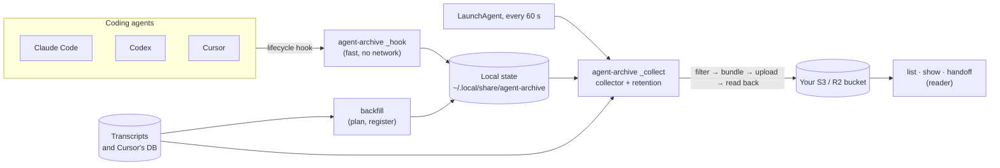
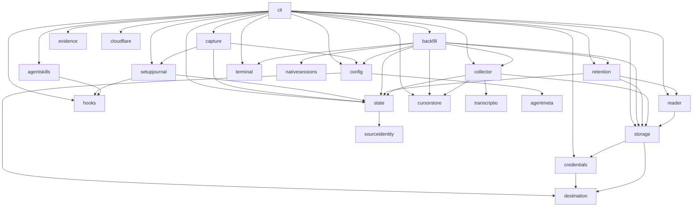

# Architecture

agent-archive is one Go binary, `cmd/agent-archive`, with everything else in
`internal/`. The design rationale is in the [archive design](../specs/archive.md);
this page is the map.

## The paths through it

1. **Hook** (`internal/capture`, run by `_hook`). An app runs `agent-archive _hook
   --harness <app>` at session start, stop, and similar events. The hook checks the
   configuration, records the session (`registrations/`) or queues work
   (`requests/`) under `hooks.lock`, and returns within milliseconds. It does
   no filtering or uploading, never touches the network, and never writes to
   stdout. The `_hook` command in `internal/cli` is only the adapter: it
   parses `--harness`, decodes stdin, and always exits 0, recovering a panic
   into a diagnostic.
2. **Collector** (`internal/collector`, run by `_collect` or `sync`). Under
   `collector.lock`, for each registered session it reads the transcript,
   filters it through the app's adapter, builds a source bundle, derives
   metadata, and publishes source then metadata, verifying the source in
   storage (its SHA-256 and size, or a read-back where the service reports
   no checksum) before the metadata points at it. Retention runs after each
   pass.
3. **Reader** (`internal/reader`). `list`, `show`, and `handoff` read the
   bucket: metadata first, and a source only when asked, verified against
   the metadata's checksum.
4. **Backfill** (`internal/backfill`). Plans an import of existing
   transcripts read-only, then registers the confirmed sessions in short holds
   of `hooks.lock`; the collector uploads them like any other.

## Packages

| Package | Owns |
| --- | --- |
| `agentmeta` | Standard-library-only canonical identities, aliases and immutable catalogs; unknown archive names remain representable. |
| `agentmeta` wire sizing | Standard-library-only JSON wire sizing at the existing pure metadata boundary, without encoding a document or accessing native, local or remote state. Archive and operational callers share one counter; stats consumers reach it only through archive. |
| `jsonwire` | Standard-library-only bounded JSON streaming encoder and its matching preflight; writes only to a caller-provided writer under caller-owned byte reservations. It does not open files, inspect native state or replace the pure `agentmeta.JSONWireBound` API. |
| `agentapi` | Pure narrow operation contracts for launch/runtime, lifecycle, hooks, source/filter/parser/preview, purpose-specific discovery, native projects/catalogs and read-only transcript-path recognition, skills and capability/version evidence. Shared consumers request only their operation. |
| `agents/claude`, `agents/codex`, `agents/cursor` | Native vocabulary, formats, argv/environment, locations, ownership and bounded interpretation. Pure codecs and planners never perform shared capture/publication or apply setup transactions. Source implementations own serial native reads. |
| `agents/muse` | Injected runtime presence, session cleanup, strict local file source/filter, live local snapshot content proofs and provisional startup facts, retained-only own-conversation parser and bounded automatic handoff discovery/headers/name/activity previews; capture contexts refuse before reads. No version probe or launch implementation. |
| `agents/builtin` | Immutable production operation bindings and precomputed runtime/cleanup projections; composition does no filesystem, version or executable probing. CLI composition injects narrow lookups into real consumers. |
| `testutil/agenttest` | Launch and runtime conformance suites called by each native integration's tests. |
| `archive` | Pure shared privacy policy, source envelope, normalized Analysis values and metadata/transcript/handoff builders. Native filtering and semantic parsing live in integration codecs; builders consume one caller-owned Analysis. |
| `codexmeta` | Pure bounded Codex thread/root/parent/fork and physical rollout metadata interpretation; source facts do not authorize capture. Archive shares its canonical producer-source projection; stats consumers reach it only through archive. Its dependency guard permits pure standard-library interpretation and refuses file/process/network/random or clock access. |
| `nativesessions` | Shared bounded no-setup discovery orchestration, header reservations, symlink/scope/cancellation policy and coverage. Injected native providers own purpose-specific roots and header interpretation. Import keeps its separate compatibility bounds. |
| `transcriptio` | Verified regular-file snapshots, captured read boundaries and complete-record bounded head/tail windows. No native discovery or archive policy. |
| `collector` | The scan, build, publish loop; change detection; subagent capture. |
| `state` | Per-session local state: registrations, requests, published and pending publications, change detection, removal records, and the per-session locks (`Store`; see [local state](../../docs/reference/local-state.md)). `state/statetest` has test helpers. |
| `retention` | Deleting superseded snapshots and expired sessions, with the remote metadata as the source of truth. |
| `storage` | The object-store contract and the S3/R2 implementation; checksums, read-back, bucket privacy inspection, and `Diagnose`, which names a storage failure's cause in plain words. Keys are relative to the configured prefix. `storage/storagetest` has the in-memory store tests use. |
| `cloudflare` | Cloudflare's management API, only what guided R2 setup needs: list accounts, create a bucket, create and revoke a bucket-scoped API token, read public-access settings. Used at setup time with a pasted bootstrap token that is never stored; `cloudflare/cloudflaretest` is the fake tests use. |
| `credentials` | Resolving storage credentials: AWS profiles, and R2 secrets in the Keychain (cgo, Security.framework). |
| `destination`, `sourceidentity` | Pure persisted destination/privacy values and legacy source signature values. Public host-package aliases preserve schemas while config/state avoid credential, network and database client dependencies. |
| `config` | `config.json`: the one record of how this machine is set up. |
| `local` | The data directory, atomic durable writes, and file locks. |
| `platform` | The one place that knows the operating system: `platform.OS` (`Darwin`, `Linux`, and an `Unknown` that fails closed), `platform.Current` (the only non-test reader of `runtime.GOOS`, `TestOnlyPlatformReadsRuntimeGOOS`), and `Locations`, shared temporary directories, privacy-protected folders and the Cursor snapshot root; native providers declare application and desktop workspace locations. Pure: it runs no program and opens no file (the two inputs that need the system come in as `LocationDeps`), and imports no `credentials` or `hooks` (depguard and `TestPlatformImportBoundary`). |
| `hooks` | Checking, planning, installing, and removing the hook entries in the apps' hook files. |
| `scheduler` | The port to whatever runs the background collector: `Ref`, `Site`, `JobState` (the words `status` reports), the desired state of a job (`Installation`, `JobSpec`, and `Plan`, a pure rendering of a definition as file `Artifact`s), what a scheduler reports (`Status`, with the `Problem` facts and `Words` nouns the commands' messages are filled from), the `Scheduler` interface (`Definer`, `Inspector`, whose `Installed` lists an installation's own job and its aliases, and `Controller`), `Retiree`, the job setup retires, the `NotOwnedError` and `IndeterminateError` an `Unload` refuses with, and the `Runner` an adapter runs its tool through. Pure: it runs no program and imports no `credentials` or `hooks` (depguard and `TestSchedulerImportBoundary`). |
| `scheduler/launchd` | The macOS adapter: the LaunchAgent plist (planning it and reading its program, environment and data directory back), the collector's labels and every earlier one (`Installed`: the labels earlier releases gave the collector, and the prototype's upload job), and the `launchctl` calls that ask about, load and stop a job, all through the `Runner` it is given. |
| `scheduler/systemd` | The Linux adapter: the collector as two user unit files, a oneshot service and a timer (planning them and reading the program, environment and data directory back from the service), the unit names that are its refs, and the `systemctl --user` calls that ask about, load and stop a job, all through the `Runner` it is given. |
| `testutil/schedulertest` | Test helpers for the port: `Model`, a scheduler that is not launchd, and `RunConformance`, the suite every adapter passes over a fake `Runner`. |
| `scheduler/host` | Chooses the adapter for the system (launchd on macOS, systemd on Linux; on another system, a scheduler called `none` that says every job is unknown and refuses changes) or by the name `config.json` records (`background_backend`; `Lookup`), and owns the real `Runner`: the program in a process group of its own, output combined, with the variables that reach the user's systemd manager for `systemctl` and `loginctl`. Only `host` imports an adapter (depguard and `TestOnlyHostImportsAdapters`); running a program is limited to a listed set of packages (`TestOnlyListedPackagesRunPrograms`). |
| `agentskills` | Shared rendered skill templates, path/content deduplication, ownership, refresh/removal and setup-journal plans. Injected native skill providers declare installation and evidence roots separately and inspect/plan observed bytes. |
| `capture` | The hook runtime: classifying a hook event, admitting a new session or continuing a registered one, lifecycle and final-response evidence, subagent links, and the content-free capture diagnostics status shows. It imports nothing from the command line, even transitively, and does not itself import anything that runs a program, opens the Keychain, or uses the network (config uses pure destination values); depguard and `TestCaptureImportBoundary` enforce this. The one program a hook does run is `git`, for the repository key and the checked-out commit: `cli` passes in the lookups, which run before `hooks.lock` is taken, at the same time as each other, only for a new session in an archived project (and, for HEAD alone, at a stop of a registered one), and are abandoned after 600 ms. |
| `gitremote` | The only place the program runs `git`: reads a project's `origin` with a 500 ms timeout and returns `archive.RepoKey` of it, and reads the commit a working directory has checked out and whether its tree is dirty (`Head`, `Dirty`, `HeadState`; see [the commit a session started on](../proposals/implemented/git-head.md)), each "" or nil on any failure. It runs git itself (one of the packages `TestOnlyListedPackagesRunPrograms` allows), behind its own injectable `Runner`, not a `scheduler.Runner`. `capture` may not run programs, so `cli` hands the hook these lookups (`capture.WithRepoKey`, `capture.WithGitHead`). |
| `setupjournal` | Setup's transaction (`setup-transaction.json`): writing the journal before any hook file or the LaunchAgent changes, rolling a failed setup back, recovering an interrupted one without overwriting later edits, and recording the prototype's job and the collectors installed under earlier labels that setup retires (which jobs those are is the scheduler's to say). A scheduler is reached only through the `Backends` its caller passes (cli's `Env`), which resolve the backend name each journal records, so every job is driven through the backend that made it. Every command and the hook check whether a journal is pending. |
| `evidence` | Skill inventories and snapshots, as privacy-filtered evidence. |
| `cursorstore` | Reading Cursor's `state.vscdb` without writing to it or beside it. |
| `backfill` | Shared import budgets, project policy, plan, registration and undo. Native integrations stream discovery candidates and interpret filtered admission facts; Cursor declares its compact database catalog through borrowed row callbacks. |
| `nativesessions` | Shared bounded no-setup discovery orchestration, header reservations, symlink/scope/cancellation policy and coverage. Injected native providers own purpose-specific roots and header interpretation. Import keeps its separate compatibility bounds. |
| `transcriptio` | Verified regular-file snapshots with private file identity and a fixed read boundary, context-aware reads, and complete JSONL boundaries. Discovered files can require store containment; explicit inputs keep symlink compatibility. No archive policy, network, program, or UI dependencies. |
| `reader` | Listing metadata and loading verified sources, with a disposable metadata cache. |
| `trace` | `AGENT_ARCHIVE_TRACE`'s recorder: process-wide, so `storage` (each request), `reader`, `state`, `collector` and `config` record spans without a context threaded through every command. Spans carry fixed names, durations and counts only. Standard library only. |
| `cli` | Every command: flags, prompts, rendering, and the wiring between packages. Terminal output takes its colors, symbols, wrapping, and spinner from `ui.go`, which prints plain text when output is not a terminal, `NO_COLOR` is set, or `TERM` is `dumb`. The `stats` screens are pure page functions (`renderPage` in `stats_render.go`: numbers and a view in, lines out) with one color table (`stats_colors.go`). Process state (args, stdio, the clock, the home directory, launchctl, the Keychain) reaches commands through an injectable `Env`. A few lower packages still read the process directly: `local` (`AGENT_ARCHIVE_HOME` and `$HOME`), `credentials` (AWS configuration files and the Keychain), and `cursorstore` (the user's temporary directory, through `getconf` on macOS). |
| `statsfmt` | How `stats` writes a number: token counts (`4.9M`), money, percentages, ordinals. Shared by the terminal screen and the page so one number reads the same on both; pure, imports only `archive` (depguard and `TestFormattersImportBoundary`). |
| `statshtml` | Renders the engine's `stats.Stats` as one self-contained HTML page for `stats --html`: an embedded `html/template` and stylesheet, inline SVG charts (daily bars, a token-composition donut), no script and no external request, valid as strict XML, light, dark, print and forced-colors. Pure: it imports only `stats` and `archive` (depguard and `TestRendererImportBoundary`), reads no clock, and every name reaches the page as a `string` that `archive.DisplayLine` has cleaned and the template has escaped (`TestNothingIsMarkedTrusted` forbids the `template` types that skip escaping). Project, skill and MCP server names are replaced by "project A", "skill A", "MCP server A" unless asked for. |
| `stats` | The numbers behind `stats`: tokens, sessions, estimated cost, agents, models, projects and highlights over a window of days, computed from session metadata by one pure function (`Compute`). It takes the metadata, the time, the time zone and a price table as arguments, so it reads no clock, file, environment or network and imports only `archive`'s types (depguard and `TestStatsImportBoundary` enforce this). Cost comes from a dated, versioned price table embedded in the package (`prices.json`) that a person's own JSON file can override; a model the table does not list is left unpriced, never guessed. |
| `doclinks` | A test that the documentation's relative links resolve. |

## Package dependencies

Arrows point at what a package imports; `local` and `archive`, which nearly
everything imports, are left out. Only `cmd/agent-archive` imports `cli`; `capture` and
`setupjournal` never import `cli`, `terminal`, or `golang.org/x/term`
(depguard in `.golangci.yml`, and a test in each package).

## Invariants worth knowing before you change anything

- Nothing leaves the machine except what an adapter's filter kept. Unknown keys
  are dropped and named, never passed through. See
  [privacy](../../docs/security/privacy.md) and [versions](../maintainers/versions.md).
- The bucket's `metadata.json` is the live pointer. A source is uploaded
  before the metadata that points at it, and deleted only after it is no
  longer pointed at.
- Pending publication bytes are frozen before the first remote write, so a
  retry uploads byte-identical objects.
- Local writes are atomic and durable (temporary file, fsync, rename,
  directory fsync). One unreadable state file is quarantined, not fatal.
- Hooks must be fast and silent: an app waits for them. `capture` waits at
  most a second for `hooks.lock` and 50 ms for `diagnostics.lock`, and the
  `_hook` command exits 0 whatever happens.
- Every side effect in `cli` goes through `Env`, so tests never touch the real
  home, launchd, Keychain, or a bucket.

The test-only Orbifold integration uses its own record framing, field vocabulary and
retained format through the normal registry and shared consumer pipeline. Its
synthetic success establishes extension coverage only; it creates no production
agent or installed-version verification. The contributor recipe identifies the
ports and capability-specific checks required for a new implementation.

Changed Codex scans reconcile the thread's own physical segments on its current
chain (the rollout Codex's index names, then each rollout its history base
names), then any observed same-thread rollouts off that chain, best effort.
Off-chain rollouts never block selection. Historical reads use the existing
native admission and source-home checks, close each snapshot before the next
read, and retain independent aggregate bounds for raw bytes, filtered records,
filtered bytes and compressed stages. A chain the lookup cannot resolve (a
missing base) fails that scan, which cannot acknowledge a request or settle its
signature. Meaningful preservation compares owned logical ordinals
through the native record comparator; file sizes and copied headers supply no
coverage evidence. One physical revision receives one latest verified retained
entry, including an outgoing append first seen during reconciliation. Newly
observed historical evidence uses the reconciliation observation time; an existing
verified candidate keeps its capture time. Publication, frozen journaling, all-reference maintenance and retention require
complete supported authority; unknown identity/schema evidence remains pending.

Ordinary retained source2 snapshots still supply privacy maintenance inputs when
their stale filter version disagrees with the cached acknowledged sidecar. This
compatibility path requires a supported ordinary sidecar and matching ownership,
identity, capture time and acknowledged source reference; it does not certify
complete history authority. A physical revision transition validates the complete
remote source set before planning, and the exact predecessor/final metadata preflight still applies. Recovery must not replace a valid ordinary maintenance input merely to
clear its stale privacy version.

The collector now freezes reconciled Codex revisions into its existing pending
journal before publication: the active source and new preserved sources are
staged privately first, and the complete manifest retains per-input capture,
filter and source-schema provenance plus the exact acknowledged predecessor SHA.
Preparation consumes one retained input per pass and persists its cursor with
`Attempted=false`. Restart uses those inputs even after native files disappear;
newer requests cannot bypass the history journal. Policy changes retain the
journal and stages pending complete all-reference successor preparation.
Final publication verifies all references before exact predecessor preflight and
metadata PUT, then verifies exact readback before recording cleanup, cache and
token acknowledgement. Committed retries skip source and metadata PUT.

Stage cleanup reads one bounded directory batch under collector ownership and
protects live descriptor stages and preparation inputs. It refuses symlinks,
unsafe names and nonregular stages; failures remain pending. Acknowledgement
removes private stages before its journal, so failed stage cleanup retains a
retry record. Missing frozen stages can be recovered only from the exact
checksum-verified remote object, never from newer native bytes. Expected-SHA
preflight and exact readback detect observed conflicts under the local collector
lock; unconditional object-store PUT does not exclude an out-of-band writer
racing between the preflight GET and PUT.

Retained Codex privacy preparation now accepts validated source3 bundles through
the adapter's retained-record port. It preserves physical spans, exclusive raw
ordinal bounds, retained ordinal omissions, thread ownership, OwnStart and original
capture times. Source2 alternatives keep their own format and per-reference
provenance. Preparation loads original checksum stages independently of the final
source list, so an earlier slice cannot make a replaced original unreadable.
Supported complete acknowledged history can enter private sequential maintenance
under the frozen journal; the complete final sidecar is derived only after
all inputs finish. Retained maintenance uses the recorded repository key rather
than the pass's current Git lookup. All references finish before metadata publication or request completion. A live
request retains its native-read obligation after parser/privacy maintenance; frozen
generations acknowledge their retained hook observations.

A stronger-policy retry first resolves the exact remote predecessor or final
sidecar. Unknown state retains the attempted journal. When the predecessor still
exists, a stricter successor validates original pending inputs, final references
and acknowledged references, stages all inputs and outputs before replacing the
journal, and preserves capture facts and cleanup obligations. An exact committed
final is identity-decoded across every reference and read back again; its journal
records a maintenance obligation before exact acknowledgement. The stricter
successor remains owed, without re-uploading broader source or metadata bytes.
An unavailable original input keeps that obligation and can recover only from
exact verified retained bytes. Generation recovery keeps the original whole set frozen and creates an independent
self-contained successor. Compact summaries and signatures retain source-set digest,
revision, schemas, completeness and meaningful capture age. Retention protects all
references and rechecks the current set before deletion; whole-prefix deletion
removes metadata first. Privacy/parser/link-only work preserves meaningful age.
The native/index charged ledger does not bound process RSS: retained decode/filter/
compression/comparison scratch and staged disk are separate performance evidence.

Local [native validation checkpoints](../specs/native-validation.md) are nested
inside protected bindings. A collector-private lease owns native input until the
prepared state commit finishes. Its independent verifier runs after staging and
before the short hooks/request policy fence; staging and directory fsync remain
outside that fence. The durable checkpoint is independent of disposable scan
signatures and frozen publication acknowledgement. Muse capture remains fenced.

Shared native inventory lives at the existing discovery boundary and composes a
strict startup eligibility callback through builtin. It does not use Codex
admission or create owners. The collector owns one context-bound lookup factory,
independently frozen current eligibility, exact historical cohort scope and
source-before-inventory closure. Pure pending readers
retain the original nil prior binding through real filtering and guarded commit.
Generic rooted filesystem opening lives in transcriptio; sourcefacts keeps its
compatible alias/forwarder so native integrations need no Codex fact dependency.
