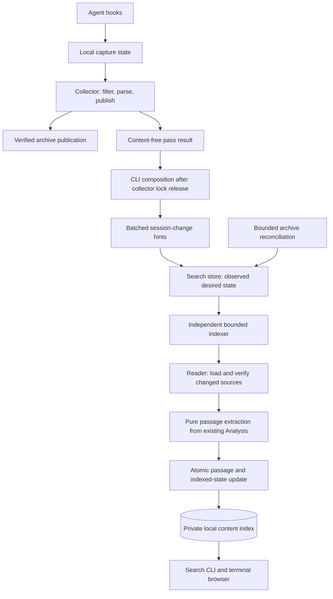

# Conversation search with incremental indexing

Status: proposed; no content-search implementation or performance evidence yet.
Updated 2026-10-14 after architecture review: incremental indexing with
consumer-owned work state and optional batched session-change hints.

## Outcome and scope

Find archived sessions by words inside their conversations, show the passage
that explains each match, and open the transcript at that passage. Make the
history searchable incrementally as verified session publications arrive,
rather than doing the normal indexing work when a user searches.

The first version searches titles and visible user/assistant text from supported,
filtered archive sources. Exclude tool output, reasoning, injected instructions,
and attachments initially. Use existing native interpretation rather than
searching raw JSON or shortened handoff renderings. Extraction must distinguish
visible messages from generated setup context and repeated native records.

Provide a new `search` command, terminal results with snippets, and bounded JSON
results with passage references. Keep existing `list`, `show`, and `handoff`
selection semantics. Reuse project, harness, date, replay, and child-session
filters, applying scope before ranking and limiting. Default to the current
project; broadening requires an explicit option. Start with case-insensitive
keyword and quoted-phrase matching; define prefix behavior explicitly. Semantic
search, MCP, native local search before setup, and remote search services are
outside this first version.

## Architecture and ownership



Publication is authoritative. Indexing failure must not fail publication, delay
its acknowledgement, block retention, or hold publication locks. Hooks do no
search I/O. Existing read commands do not refresh the content index or download
transcripts for it. The collector does not import search or open its database.

CLI composition may pass content-free session hints to enabled follow-up consumers
only after the full collection/verification/retention function has returned and
released its lock. A hint says to recheck a session; it is not evidence that a
particular source exists or that a removal is authoritative. The search consumer
resolves authoritative metadata outside the capture path. Hints are best effort:
a busy consumer, process exit, or failed notification cannot affect capture.
Reconciliation is the recovery path, not an extra durable publication outbox.

Keep implementation small: a pure passage projection, one concrete SQLite search
store, a bounded indexer/reconciler, and thin CLI composition. Reuse reader
verification and agentapi parser lookup. NormalizedTurn already carries
RecordIndex and TurnKind; extend the existing interpretation only where location
or visibility evidence is insufficient. Do not create per-agent search parsers,
a second transcript representation, or a generic repository/interface layer.

## Session-change follow-up extension point

A narrow reusable notification boundary is useful for search and later derived
analyses. It invalidates derived state; it does not execute arbitrary jobs.
The following is a design sketch, not a new public API or shipped code:

```go
type SessionChangeBatch struct {
    DestinationID string
    SessionIDs    []string // bounded, deduplicated, no transcript content
}

type SessionChangeSink interface {
    Hint(context.Context, SessionChangeBatch) error
}
```

Consumer registration is an explicit compile-time list in CLI composition.
Resolve the destination from the pass's captured configuration, not config
reloaded after the pass. Sinks must not retain mutable caller-owned slices.
There is no dynamic plugin registration, global event bus, payload schema
registry, dependency DAG, or generic durable job queue.

`Hint` performs only a bounded local invalidation/write or wake request. It must
honor cancellation and use bounded database busy timeouts; it does no network
reads, parsing, or actual follow-up computation. Total notification work has an
aggregate budget and per-consumer budgets; a slow sink cannot consume the entire
budget before others get a chance. Dropped batches are acceptable because each
enabled consumer must reconcile independently. Cap batch size and retained hint
state; do not keep an unbounded slice of historical publications. Errors go to
consumer diagnostics and never replace capture errors or change sync exit codes.

The existing collection Result.Published provides local publication candidates.
It is not a global session-change stream and carries no guarantee of final
existence after retention. Publication can succeed even if the overall pass
returns an error; notify known candidate IDs on that path too, after lock release.
Backfill shares runPass and must use the same composition boundary. Deletion,
privacy changes, other-machine publications, and mutations outside collection
are covered by reconciliation; add other producers only when their existing
outcomes supply useful hints, not by changing every mutation API upfront.

Do not fire-and-forget goroutines from an exiting CLI, spawn a process per session,
or synchronously run handlers from the collector. A supervised scheduled worker
executes follow-up work in bounded passes. Periodic ticks guarantee eventual
progress under healthy scheduling; an optional coalesced wake improves latency
but is not required for correctness. Decide exact launchd/systemd job identity,
logs, setup rollback, refresh, pause and uninstall ownership before wiring it:
current scheduler adapters use collector-specific identity/log conventions, so
changing JobSpec.Args alone does not establish a separate safe job.

Start with only the search sink/worker. Keep any notification fan-out helper in
composition; do not introduce a general jobs package before a second real
consumer needs shared behavior. Consumers own desired/completed versions,
retry/backoff, batching windows, and artifacts. A future batched analysis can
wait for a quiet window or a minimum due batch without changing publication.
Failures in one consumer do not block others; share a process budget if a common
scheduled runner is introduced. Jobs requiring every intermediate revision or
irreversible exactly-once side effects need a separate design: coalesced hints
and current-state reconciliation do not provide those guarantees.

## Work state and retry lifecycle

Use one persisted desired-versus-indexed state in the search database, not a
separate durable queue, acknowledgement file, or publication journal extension.
A local hint can set a recheck flag without claiming a new desired revision.
Reconciliation and authoritative reads supply desired state.

Separate three identities:

- Searchable metadata fingerprint: title and filter/display facts. A metadata-only
  change updates those columns without fetching/parsing unchanged transcripts.
- Source identity: exact source checksum and verification/ownership provenance.
  Cache extraction per supported source within a destination, so unchanged
  preserved sources are reused when the active source changes.
- Extraction contract: parser/extractor and privacy versions. A change invalidates
  only the projections whose interpretation is no longer valid.

A session row records desired and indexed source membership, metadata fingerprints,
work generation, next eligible attempt, failure/backoff state, and last observation.
Pending work is a mismatch or a recheck flag, not a second persisted queue.

1. Hints or reconciliation mark a session for authoritative recheck.
2. Resolve current metadata and source membership through the existing reader.
3. Select eligible work with one writer and one source in flight initially.
   Download, verify, parse and extract outside database write transactions.
4. Build new passages privately; reuse unchanged source projections and skip FTS
   rewrites when the passage projection is unchanged. Do not retain source bundles
   by default merely to implement search.
5. In a short transaction, validate the expected work generation, update affected
   passages/membership/metadata, and commit indexed state together. A newer desired
   state remains pending; a stale attempt cannot overwrite a newer indexed view.

Retries are idempotent; no separate post-commit acknowledgement is necessary.
Unknown or deleted sources remain unsearchable where required by privacy or
membership checks. Retry failed work with backoff without starving other sessions.
Report oversized/unsupported sources explicitly rather than repeatedly restarting
an impossible unit. Initial loads still obey existing compressed/decompressed
reader limits; passage caps alone do not bound parser memory.

Coalesce active-session changes using an indexing refresh interval independent of
upload cadence. Prioritize completed sessions, with a maximum lag target for
active ones under healthy capacity. Choose numerical defaults from measurements.
A changing session cannot continually reset its eligibility and starve forever.
Initially parse changed source snapshots in full, measuring cumulative lifetime
cost. Append-aware extraction is deferred until safe append identity and savings
are demonstrated. Collector-side passage staging is outside the initial scope.

## Reconciliation, catch-up, and source history

Every machine maintains its own disposable index. Local publications supply
prompt indexing hints; bounded, resumable reconciliation discovers publications
from other machines, missed hints, changed metadata, and removals. Reuse
the current catalog's authority and freshness contracts rather than assuming
object storage provides a change feed. Bound reconciliation work and measure its
discovery cost separately from source downloads and indexing.

An existing archive or new machine requires initial catch-up. Feed it through
the same desired-state reconciliation and worker, with persisted progress and
project/date prioritization. Prioritize recent publications over old catch-up
without indefinitely starving older work. Search does not wait for exhaustive catch-up unless explicitly
requested. Partial discovery must never authorize deleting unseen entries or
claiming complete coverage.

Before implementation, define search coverage of active and preserved revisions
against the existing Codex history contract. The intended coverage is supported
retained conversation history, with source-bound hits. Deduplicate proven native
echoes and inherited source intervals within a session; do not build a global
text-deduplication system or merge intentionally repeated prompts. Do not silently
label current-revision-only extraction as complete for a session with preserved
alternatives. Track unsupported or unreadable retained sources as coverage gaps. Published fragments remain outside coverage until
their consumer contract ships.

Replace entries when sources or extraction semantics change. Reconcile metadata
changes such as titles without re-extracting unchanged sources. Remove entries
for confirmed deletion or retention expiry. On observing privacy maintenance,
invalidate affected text before serving further results; do not keep serving an
old projection while a stricter replacement is pending. A local index cannot know
about an unobserved remote deletion or policy change. Report last observation
time and provide explicit refresh; do not promise immediately current results
while also promising network-free queries. Scope invalidation to supported
provenance and fail closed when it is unknown. Ordinary source changes may
temporarily leave older indexed results, provided freshness is visible and passage opening verifies the referenced state.

## Local storage and query behavior

Keep content storage separate from the metadata-only SessionCatalog. Partition by
archive destination and installation/privacy context. Use private directories
and files, versioned schemas, and a rebuildable index. SQLite FTS5 is the initial
candidate; verify support in the bundled driver and test code identifiers,
filenames, punctuation, Unicode, and quoted error strings before fixing query
semantics. Escape user input deliberately rather than exposing accidental FTS
operators. Do not add a new network service.

Index individual messages or bounded passages within large messages. Preserve
enough text for snippets without downloading whole transcripts during queries.
Keep native deduplication and inherited-history ownership in the extraction
boundary. Group hits by session and return its best passages, not one result per
repeated occurrence. Define deterministic ranking combining title/phrase matches,
text relevance, role, and recency, backed by representative retrieval fixtures.
Apply scope filters before final grouping/limiting; compute snippets only for
selected results. Inspect query plans and broad-term workloads: an output limit
alone does not bound FTS ranking or per-session aggregation. If candidate limits
are needed, report partial coverage instead of silently dropping valid sessions.
Keep reader transactions short and bound writer busy waits and journal growth;
indexing progress must not hold a query open, and queries must not pin storage
indefinitely.

Search uses the existing index without synchronous full-archive discovery. Return
last reconciliation time, known pending/failed counts, and coverage limitations.
Distinguish complete coverage at an observed archive snapshot from current global
freshness. A first search shows catch-up progress rather than implying no matching
history exists. Provide explicit refresh/wait and rebuild controls; interruption
must preserve resumable progress. Define pagination consistency explicitly:
use deterministic keyset ordering within a bounded read view if feasible; do not
hold a database read transaction across user think time. If generations invalidate
cursors, test paging under continuous indexing and disclose restart behavior.
Do not claim exhaustive stable pagination from a candidate-limited query.

Passage references identify the session, source revision, extraction version,
and message/record location; rendered transcript line numbers are not stable
identities. Opening a hit verifies its source and opens surrounding context, or
reports that it changed or is no longer available. JSON supports bounded snippets
and further context retrieval; terminal output applies existing display escaping.

## Performance and operational requirements

- No content indexing work in hooks, existing read commands, or publication
  locks. Only best-effort bounded batched hints are added after the collection
  function releases its lock; measure even that overhead.
- Indexing consumes ongoing CPU, disk, and network resources even though search
  does not wait for it. Bound concurrency, pending-state growth, per-pass work, source
  reads, passage sizes, and memory; expose backlog and refresh controls.
- Coalesce active-session publications. Initially rebuild changed source
  projections; add append-only parsing only after proving valid append identity
  and demonstrating worthwhile savings. Rewrites require replacement. Measure
  cumulative lifetime read/parse/write amplification, not only per-pass latency.
- Search result limits do not bound ranking/grouping work. Measure common-word
  queries, large matching sets, and per-session aggregation explicitly.
- Measure local text/index disk growth separately from optional source caches.
  Document cleanup and rebuild behavior, including privacy invalidation.
- Do not claim zero overhead or set latency guarantees before measurement.

## PR breakdown and delegation contract

Planning only: no implementation run, worker assignments, branches, pushes, PRs,
or merge authorization are established by this document. All PRs below are
**planned**. The user will review this plan before invoking implementation.

The decomposition follows the
`implement-with-subagents` skill.
Resolve its installed SKILL.md at execution time; a future orchestrator must
read its then available skill rather than assume a host-specific path exists. This tracked
proposal is the requirements/design input, not the live orchestration record.

### Starting inputs and run setup

Planning baseline: `7d8aee13c7146ceb38d15df7188d7daa31f464eb`. In-scope local
changes are this proposal and its entry in `dev/proposals/README.md`. They may
still be uncommitted when implementation starts. The orchestrator must preserve
and capture those exact inputs in its isolated starting checkout; starting from
clean HEAD alone would omit the plan. Recheck live repository instructions,
base, local changes and existing PRs before beginning; do not assume this
baseline remains the implementation target.

On explicit implementation authorization, use the skill's external run-state
template in a unique permitted run directory outside tracked source. Record the
actual base/target, captured plan revision, merge choice, worker checkouts and
branches, report paths, PR URLs, pinned review/check heads, findings/fixes, and
combined integration evidence. The orchestrator alone owns that live record;
workers return reports and do not edit it or redesign this proposal independently.
Do not create that run directory or ask for a merge choice during this planning
turn. During implementation, ask once if merge choice remains unspecified and
use handoff while awaiting an answer. No merge authority is implied here.

### PR graph and integration order

| ID | Proposed PR title | Dependencies / actual base | Suggested branch suffix | Current state |
| --- | --- | --- | --- | --- |
| S1 | Add a verified conversation-search engine and baseline benchmarks | Recorded target branch/base at run start | `search-engine` | Planned |
| S2 | Add coalesced indexing state and a bounded index worker | S1 merged head, or explicit S1 stack head | `search-worker` | Planned |
| S3 | Reconcile archive changes and resume search catch-up | S2 merged head, or explicit S2 stack head | `search-reconcile` | Planned |
| S4 | Expose search, refresh and passage reads through CLI and JSON | S3 merged head, or explicit S3 stack head | `search-cli` | Planned |
| S5 | Schedule search indexing and route bounded session-change hints | S4 merged head, or explicit S4 stack head | `search-background` | Planned |
| S6 | Add terminal search navigation and complete feature acceptance | S5 merged head, or explicit S5 stack head | `search-browser` | Planned |

Merge/integration order is S1 → S2 → S3 → S4 → S5 → S6. This is intentionally a
linear first implementation: every PR has a different behavior boundary, but
shared store/CLI/scheduler contracts make speculative parallel implementations
more costly than useful. Do not manufacture independent work to fill agent slots.
The branch suffixes are suggestions, not existing branches; apply repository
naming policy and record actual names at run start.

In merge mode, implement dependents after prerequisites merge. In handoff mode,
stack against the recorded parent when supported; show each PR's actual parent
and eventual target. Review only that PR's merge-base-to-head diff plus relevant
parent context. After squash/rebase merges, transplant child-only changes onto
the actual merged ancestry and invalidate affected review/check evidence. A
stacked PR is not independently mergeable. If stacking is unavailable, explicitly
hand off a phased sequence or combine inseparable PRs; do not wait indefinitely
for a human merge or silently omit dependencies.

### Contracts owned by S1 and consumed by later PRs

S1 records and tests these concrete package contracts before S2 begins. Change
contracts only through an orchestrator decision propagated to downstream work;
do not invent parallel versions. Keep implementation APIs unexported except
where a real cross-package caller needs them. Proposed `internal/search` owns
the pure projection and concrete store; split it only for an evidenced boundary.

| Contract | Required meaning | Later consumers |
| --- | --- | --- |
| Passage identity | Destination, session/source membership, verified source checksum, extractor version, record/message position and chunk bounds; never rendered line numbers | S2–S6 |
| Visibility and history | Existing TurnKind/parser interpretation; supported active and preserved sources; proven native/inherited-interval deduplication within a session, with explicit gaps | S2–S6 |
| Source reuse | Exact bytes plus ownership/interpretation/privacy provenance, not checksum alone when interpretation differs; metadata updates do not invalidate source extraction | S2–S5 |
| Query and result | Project/harness/date/replay/child scope before final ranking/limit; deterministic session grouping; bounded snippets and source-bound matches; completeness/freshness/cursor fields | S3–S6 |
| Work state | One desired/indexed state per session in the search DB, source projection reuse, expected-generation commit; no queue/acknowledgement side store | S2–S5 |
| Hint boundary | Bounded captured-destination/session batch, optional invalidation only; no network/parse work, no publication dependency | S5 |

S1 must fix literal-word/phrase/prefix behavior and tokenizer limitations using
fixtures, not expose raw FTS operators accidentally. It must choose and document
pagination behavior under concurrent writes. Source-bound read results must
state offsets/continuation and distinguish changed, deleted, unsupported and
unavailable sources. Exact JSON field names are owned by S4, implementing these
semantics rather than redefining them.

### S1 — Search engine, extraction and baseline

**Scope:** Implement the smallest tested vertical slice from a verified source
through the existing parser to passage extraction, concrete private SQLite/FTS
storage, scoped query, grouped results and snippets. Reuse normalized record
positions and display escaping. Support the retained-history coverage above;
record explicit unsupported-source gaps. Bring forward the minimal useful
`search QUERY` cached command, explicit `--refresh --session ID --harness NAME`
indexing and source-reference reads. The repository's production reachability gate
rejects an engine with no production callers; this is a useful final CLI surface,
not a CI exception. No scheduler, collector changes, generic task framework or
collector-side staging.

**Expected areas:** new `internal/search` and minimal CLI/help/docs; narrow shared archive helpers only
where existing interpretation cannot be consumed safely; reader/parser callers;
focused search fixtures and benchmarks under existing contributor conventions.
Do not move native parsing into search or persist Analysis as another transcript.

**Acceptance / checks:** FTS availability with the current Go driver; Unicode,
identifiers, filenames, literal error strings, words/phrases/prefixes; visibility,
native echoes, intentional repeated prompts, inherited history and preserved
alternatives; bounded long-message passages, meaningful snippets and exact
passage references; deterministic scoped grouping and documented pagination.
Use disposable stores, real parser fixtures and a verified-source integration
harness rather than testing only mock wiring.

**Performance gate:** Record cold extraction/indexing, warm queries, broad-term
ranking/grouping, selective scope, disk growth and source/FTS operation counts.
Inspect representative query plans and generate snippets only for selected hits.
Publish reproducible workload/measurement instructions and limitations. Set
initial measured budgets for subsequent PRs; if driver/tokenization or broad
query behavior fails the required contract, resolve the design before S2.
This is a focused engine slice, not permission to land unused general frameworks.

### S2 — Desired/indexed state and bounded execution

**Scope:** Route explicit session refresh through the bounded worker. Add source/metadata/extraction identities, desired-versus-indexed work
selection, source reuse, atomic expected-generation commits, coalescing,
backoff, restart recovery and finite per-pass budgets. Invoke the worker through
a focused integration harness; production command/scheduling comes later.

**Expected areas:** `internal/search` store and worker, existing reader/agentapi
injection, worker fixtures/operation counters. Preserve S1 query/read contracts.

**Acceptance / checks:** Duplicate and out-of-order rechecks are idempotent;
newer desired state cannot be lost at commit; metadata-only updates cause zero
source GETs/parses; unchanged preserved sources cause zero reparse; unchanged
passages avoid FTS rewrites; download/parse work occurs outside write
transactions. Test crashes around state/commit, cancellation, transient/permanent
failures, oversized sources, busy readers/writers and restart.

**Performance gate:** Start with one source in flight and one writer. Measure
cumulative downloads/parses/writes across growing-session publications and
coalescing intervals, plus index lag and fair progress for active/completed/old
work. Do not add append-only parsers, process-per-session execution, a separate
queue or acknowledgements to satisfy the worker tests.

### S3 — Reconciliation and resumable catch-up

**Scope:** Broaden explicit refresh with reconciled scope and feed authoritative observations into S2 using existing reader/catalog
contracts. Handle initial catch-up, other-machine changes, missed hints,
metadata-only changes, confirmed removal, privacy/parser invalidation and source
membership updates. Persist resumable scan progress with truthful coverage.

**Expected areas:** search reconciler; narrow reader/catalog access where needed;
separate search state, without broadening metadata-only SessionCatalog storage.

**Acceptance / checks:** A two-producer/disposable-archive test discovers changes
without local hints. Partial discovery never deletes unseen sessions or claims
completion. Resume interrupted catch-up, handle stale catalog snapshots/cursors,
revisions changing during scans, deletion during indexing and unknown provenance.
Observed stricter privacy invalidates results before replacement; unobserved
remote changes are described by last observation time, not immediate freshness.
All supported history membership and retention removal is reflected in results.

**Performance gate:** Count discovery operations separately from source downloads.
No full-archive scan per session or user query. Skip reprocessing unchanged views;
prioritize recent work while proving catch-up does not starve. Test bounded
memory and progress across catalog-page/snapshot expiry boundaries.

### S4 — CLI, JSON and source-bound context retrieval

**Scope:** Complete the minimal S1 `search` command with bounded JSON, filters,
pagination, coverage/freshness, explicit bounded refresh/wait and rebuild controls.
Provide a command path for reading surrounding context using a result reference.
Register the independently invocable hidden index-pass entry point S5 will
schedule, reusing S2/S3. Final names/flags/JSON schema are owned and documented by
this PR; no automatic background installation yet.

**Expected areas:** CLI dispatch and new search command files; relevant JSON
schema/help/reference docs; search query/read facades and command tests.

**Acceptance / checks:** Normal queries do not fetch remote sources or trigger
full discovery; explicit refresh can do bounded network work. A missing/partial
index reports coverage instead of implying no matching archive history. Preserve
current project defaults, explicit broadening, replay/child filters, stdout JSON
and stderr diagnostics. Bound both result and context output; support continuation
for long passages. Opening a source verifies its exact reference and reports
changed/deleted content. Refresh interruption resumes safely and wait cannot
mistake stale or failed work for completion. Existing list/show/handoff behavior
and performance are unchanged by search command registration.

**Performance gate:** Measure CLI startup plus warm query latency, broad queries,
context reads, pagination while indexing, refresh/wait behavior and peak memory.
Tests use isolated AGENT_ARCHIVE_HOME and archives, never real user history.

### S5 — Background lifecycle and reusable change hints

**Scope:** Implement the small SessionChangeSink boundary in CLI composition with
one actual production search consumer. Route known publication candidates only
after full collector lock release, including partial-error and backfill paths.
Install an independently owned scheduled index pass only with explicit search
enablement. Keep retry/batching in the search consumer; no general jobs package.

**Expected areas:** CLI collection composition and captured result context;
search hint adapter; config/setup/refresh/pause/uninstall; existing scheduler
ports and launchd/systemd adapters only as required for distinct job ownership.
Use content-free typed result facts instead of teaching collector about search.
Preserve collector.Result's existing staged-result ownership/cleanup contract.

**Acceptance / checks:** Assert hints execute outside the collector lock and
carry the original destination even if configuration changes afterward. Notify
known candidates even when a later collection stage fails; a hint is never
publication/existence authority. Cover disabled/missing/busy/cancelled consumers,
missed/duplicate/out-of-order hints, backfill, consumer diagnostics, bounded batch
sizes, aggregate/per-consumer budgets and captured slice ownership. Use a fake
second sink to verify fan-out isolation; do not invent a second production job.
Search failure cannot change collection status/exit codes or block retention.

**Scheduler acceptance:** Distinct job/log/lock ownership, install rollback,
refresh/upgrade, pause/resume, uninstall, unavailable user manager, duplicate
scheduled ticks and interrupted worker restart on both supported backends.
Periodic ticks must progress without hints; no exiting-process goroutines or
per-session spawned processes. Define that pause stops automatic indexing and
reconciliation; cached queries remain available. Explicit refresh behavior while
paused must be documented and tested. Installing or upgrading without opt-in
must not create a content index or activate a new background job.

**Performance gate:** Matched indexing-disabled/enabled hooks, collection/lock
latency, sync/backfill, existing read commands and concurrent capture. Measure
post-lock hint overhead and busy-store behavior. Set scheduler/coalescing
budgets from S1–S4 measurements; keep indexing opt-in.

### S6 — Terminal navigation, agent guidance and combined acceptance

**Scope:** Add interactive search results with best passage, other-match count
where available, surrounding transcript context and next/previous-match behavior.
Allow handing off an explicitly selected session using existing handoff gates;
search does not bypass repository-match or launch policy. Reuse the terminal
browser rather than introducing a second UI framework. Complete user/agent-skill
instructions, storage/privacy/cleanup docs and end-to-end acceptance evidence.

**Expected areas:** CLI browser/rendering and search interaction files; existing
handoff composition; owned agent-skill templates/refresh tests; docs/guides,
JSON/reference docs and benchmark/acceptance artifacts under repo conventions.

**Acceptance / checks:** Terminal and piped output, navigation, long snippets,
control-character escaping, stale/removed hits, exact passage opening and scoped
handoff. Agent guidance uses snippets and bounded context reads rather than
fetching every transcript. No MCP or content search inside existing pickers in
this release. Test durable restart/catch-up and full setup → capture → verified
publication → indexing → search → context retrieval with disposable homes/store.

**Combined gate:** Validate the full stack at pinned component/base commits and
record targeted checks required by repository policy. Re-run relevant checks
against the actual merged result when integration/merge method changes it.
Report broad-term/cold/warm/growing-session performance, resource use and
remaining live platform/provider acceptance gaps. Physical Mac/Linux scheduler
acceptance is separate from fake-runner tests; record unavailable checks as gaps,
never passing evidence. Default-on indexing is outside this plan: final delivery
remains explicit opt-in. No feature-complete claim while required checks or
supported-source coverage remain unresolved.

### Acceptance ownership and evidence

| Requirement | Owning PR | Required evidence |
| --- | --- | --- |
| Visibility, history, references, matching/ranking and source interpretation | S1 | Native fixtures, verified-source slice, query plans and measured baseline |
| Atomic work state, retries, coalescing, source reuse and bounded execution | S2 | Crash/race/progress tests and growing-session operation counts |
| Cross-machine discovery, catch-up, removal and observed privacy invalidation | S3 | Two-producer recovery tests and discovery/download accounting |
| Search/context CLI, schemas, coverage and refresh/wait/rebuild | S4 | Command/schema/continuation tests and startup/query measurements |
| Post-lock batched hints, captured destination and consumer isolation | S5 | Lock/destination/error-path tests, fake second sink and latency comparison |
| Scheduled lifecycle, opt-in/disabled behavior and background progress | S5 | Backend conformance/lifecycle tests and available live acceptance |
| Terminal navigation, safe handoff and agent retrieval guidance | S6 | Integrated browser/command/skill evidence |
| Whole-feature regression/performance and final supported-platform evidence | S6 | Pinned combined candidate, component results and explicit remaining gaps |

Each owning PR carries its focused tests and measurements; S6 integrates that
evidence, rather than deferring correctness/performance checks to a final giant
PR. Common-word searches, many hits per session, concurrent capture, partial
coverage, disabled mode and growing-session lifetime amplification are required
workloads, not optional benchmark follow-ups. Numerical budgets must be recorded
before the dependent work is called ready; measurements must distinguish observed
results from guarantees and test fixtures from live acceptance.

### Implementer/reviewer handoff requirements

At execution time assign one implementer per PR in an isolated checkout, with its
scope, acceptance, actual base/dependency heads, shared contracts, relevant repo
instructions, permitted resources/checks and unique report path. Workers may
implement/test/commit/push/open their assigned PR only when the user has invoked
the implementation workflow. They do not merge, edit another branch, launch
recursive workers or change the orchestration plan.

After a PR exists and implementer write ownership is relinquished, the
orchestrator launches a fresh independent reviewer pinned to target-tip,
merge-base and PR head. The reviewer inspects the full PR and fixes supported
in-scope defects. Any code fix requires fresh independent verification of the
new full head. Follow the skill's current readiness/repair policy without an
invented pass cap; record every finding disposition, actual check and review
head. Preserve configured models unless user/repository instructions override.

A PR is ready only with its owned acceptance met, supported findings resolved,
independent verification on the current head, required checks and dependency
context current, and no material integration gaps. Technical readiness is
separate from merge eligibility or human approval. Final handoff lists ready
PRs, parent/merge order, remaining checks/approvals, exact heads and any retargeting
needed. If work stops partway, report a partial handoff with recoverable state;
do not mark remaining planned PRs complete. No workers or monitoring are started
as part of this planning update.
